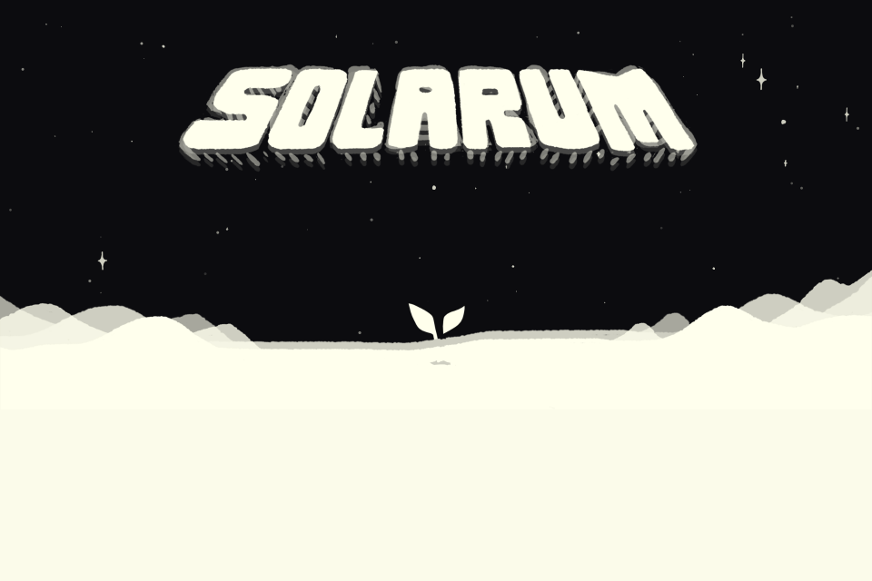
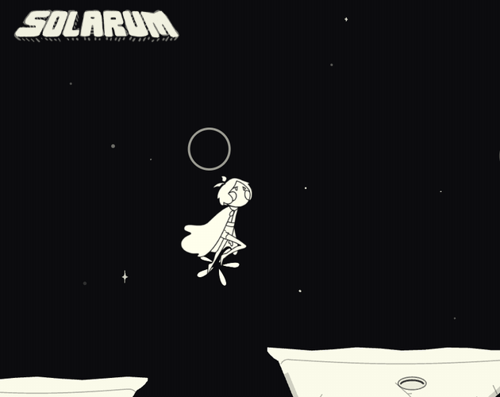
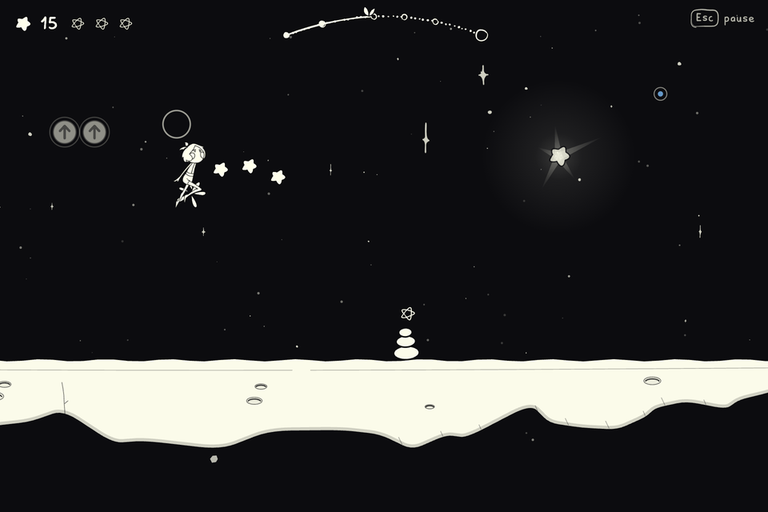
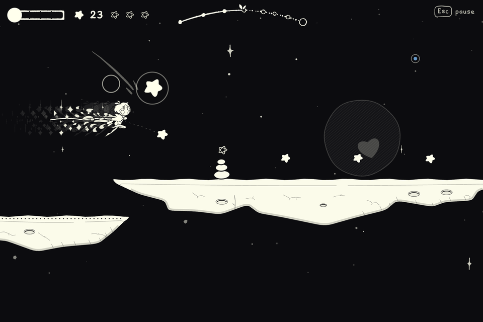
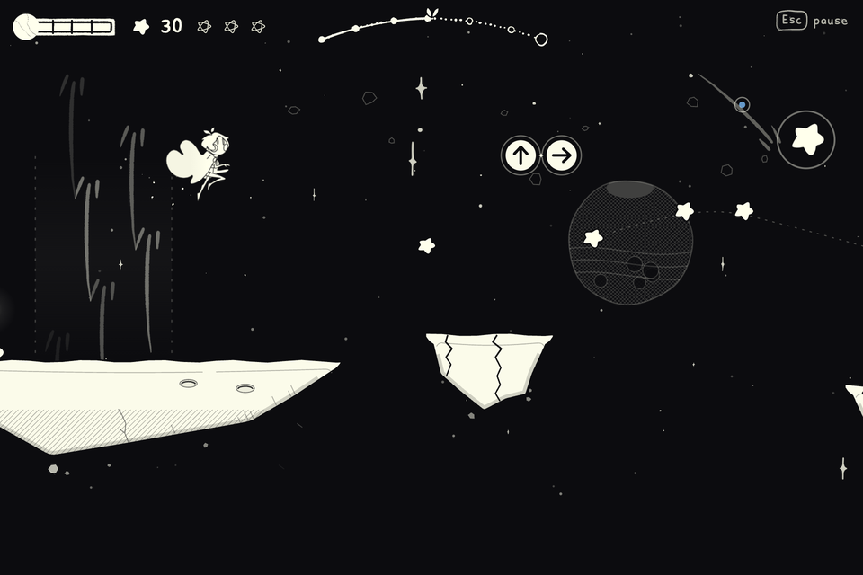
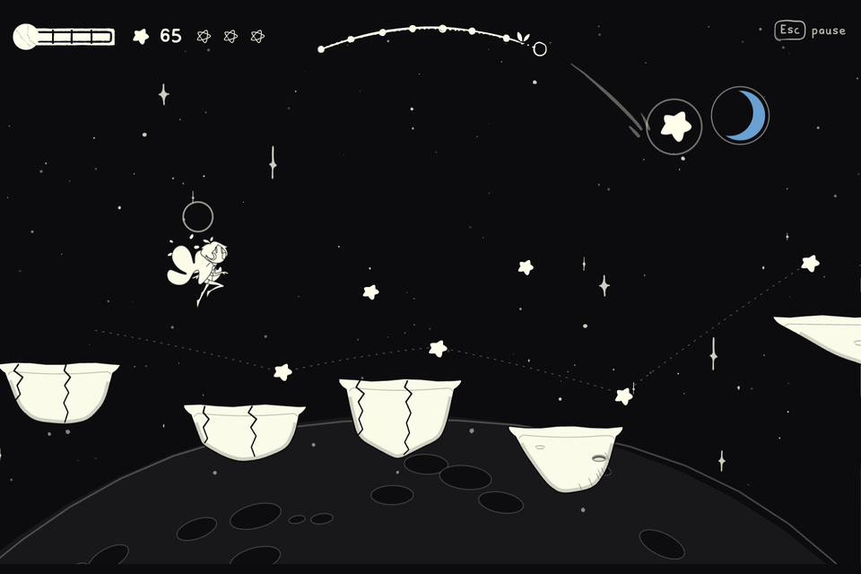

<div align="center">



# Solarum

**Run and vibes. On the sky.**

Diana runs by herself and you pick the jumps.<br>
A hand-drawn night run from the Moon toward Earth: eight short levels, keyboard only.

[](https://caucau.itch.io/solarum-2)


</div>

---

Turn the sound on and run. You can play it right now in your browser, no install, at **[caucau.itch.io/solarum-2](https://caucau.itch.io/solarum-2)**. This repository is the source.

<p align="center">
  
</p>

## About

Diana wakes up on the Moon and follows a faint signal toward Earth. She runs on her own across floating rocks. You decide when she jumps, glides and dives.

There are eight levels, each a little faster than the last, and each with one new idea: the double jump, the cape, the glide, the dive, cracked stone, the solar wind, a road that falls one tile per beat, and the super jump. The game says very little. A relic in a beam hands you the move, and the next stretch of level asks for it. The last door opens on Earth.

A few things it does differently:

- **The music is the map.** Run the line a level was drawn for and Diana's notes join the song. Fall off it and the world drifts out of tune until you find the line again.
- **A fall is quiet.** Diana drops out of the bottom of the screen, the view goes dark except for the last light and opens round it, and you have control again in about a second. No death card.
- **Stars never gate anything.** Every level has three Great Stars and none is required. Take all three and Earth glows blue inside the far door. Earth's blue is the only colour in the game.
- **Assists live in the pause card:** Gentle pace (the world at 0.8x), Endless cape, Star net and Gentle music.

## Controls

Keyboard only. There is no mouse or touch input, on purpose.

| Key | Action |
| --- | --- |
| `Space`, `↑` or `W` | Jump. Hold for height. Press again in the air for the double jump (after you unlock it). |
| `D` or `→` | Cape. Hold to glide (after you unlock it). |
| `S` or `↓` | Dive, and smash cracked stone (after you unlock it). |
| `P` or `Esc` | Pause. |
| `R` | Back to the last light. `Shift+R` restarts the level. |
| `M` / `F` | Sound on or off / fullscreen. |

On the title, `Space` wakes Diana, `←` `→` choose an open level and `C` opens the credits.

## Screenshots

<table>
  <tr>
    <td width="50%"></td>
    <td width="50%"></td>
  </tr>
  <tr>
    <td align="center"><sub>I · Waking</sub></td>
    <td align="center"><sub>II · The Gift</sub></td>
  </tr>
  <tr>
    <td width="50%"></td>
    <td width="50%"></td>
  </tr>
  <tr>
    <td align="center"><sub>VII · The Falling Road</sub></td>
    <td align="center"><sub>VIII · The Far Door</sub></td>
  </tr>
</table>

## Run it locally

You need Node.js 18 or newer. Nothing to install. The game loads ES modules, so it has to be served over HTTP, and `npm run dev` does that.

```sh
git clone https://github.com/cauesmelo/solarum-web.git
cd solarum-web
npm run dev          # then open http://127.0.0.1:4173
npm test             # routes, mechanics, camera, UI, audio, score and release checks
npm run build:itch   # writes dist/solarum-itch.zip, the file uploaded to itch.io
```

No CDN, account or backend. The art, the font, the sound and the code are all local.

## How it is built

Plain JavaScript with ES modules, a Canvas 2D renderer and a Web Audio engine. No framework and no runtime dependencies.

- The simulation (`model.mjs`) is pure: no DOM, no sound, no clock. It steps at no more than 1/120 s, so the same inputs give the same run at any frame rate. That is what lets the tests fly every level's route in Node.
- Each level is authored data (`level.mjs`) and the tests check that the intended line is reachable and fair.
- Sound is synthesised live in the browser. The score follows Diana's movement and is baked against the main route's clock.
- Only the title and the far door play the original recording; everything else is generated.

## Documentation

- [DEVELOPMENT.md](DEVELOPMENT.md): the full engineering notes (architecture, UI, sound, validation)
- [LEVEL_DESIGN.md](LEVEL_DESIGN.md), [MOVEMENT_AUDIT.md](MOVEMENT_AUDIT.md), [ANIMATION_AUDIT.md](ANIMATION_AUDIT.md)
- [CHANGELOG.md](CHANGELOG.md) and [ITCH_IO.md](ITCH_IO.md) (the export notes)
- Design briefs: [RESEARCH.md](RESEARCH.md), [RESEARCH_LEVELS.md](RESEARCH_LEVELS.md), [RESEARCH_PROGRESSION.md](RESEARCH_PROGRESSION.md), [RESEARCH_MUSIC.md](RESEARCH_MUSIC.md), [RESEARCH_TRANSITIONS.md](RESEARCH_TRANSITIONS.md), [RESEARCH_REFILLS.md](RESEARCH_REFILLS.md)

## Status

- Desktop browsers only. Tested in Chrome; Firefox and Safari have not been tried.
- The eight levels were tuned with route-following test players and have had very little play-testing by people. Some may be too hard or too easy.
- Sound starts with your first key press, because browsers do not allow it earlier.

## Credits

- **Original game:** Cauê Melo, Daniel Calônico (raenkumi), Lucas Santos (LSdS) and Rafael Lima (Kimoh).
- **Soundtrack:** Amanda (meromei) and Bruno Mareto (Bu Maré), the original music, heard on the title and at the far door.
- **Typeface:** Solarum Basic, the original game's own font.
- **In the levels:** every sound and each level's song is synthesised live in the browser.
- **Browser version:** v1.0, 2026.

The browser version was written in 2026 with an AI assistant (Claude Code): the code and the game's few words. No image or sound model was used. The pictures are the original art plus shapes drawn in code, and the level songs are made by code.

The art, music and font come from the original game, and their ownership stays with its authors. This repository has no licence file yet.
